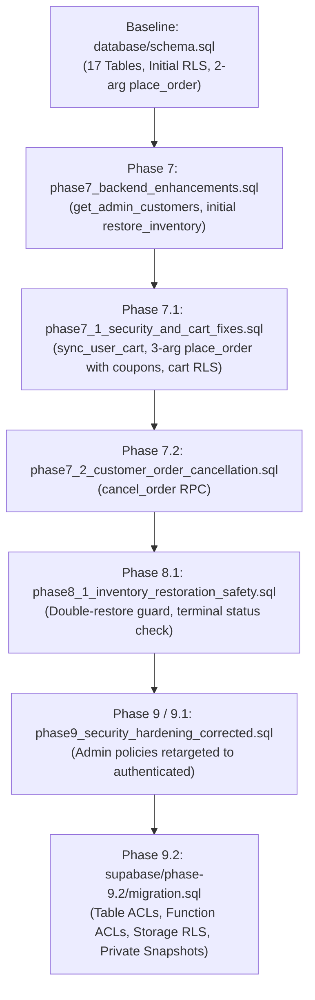

# ShopKart — Phase 2: Backend & Database Deep Audit
## Document 4: Migration History, Drift & Rollback Safety Audit

**Audit Status:** COMPLETE  
**Audit Mode:** STRICTLY READ-ONLY  
**Migration Repositories:** `database/migrations/` (14 files) & `supabase/phase-9.2/` (3 core migration files)  
**Baseline Reference:** `database/schema.sql`

---

## 1. Migration History & Chronological Topology

The database migration architecture has evolved across multiple distinct development phases:

---

## 2. File-by-File Migration Catalog

### 1. `database/schema.sql` (Baseline)
- **Status:** Baseline definition (1,067 lines).
- **Contains:** 17 public tables, extensions (`uuid-ossp`, `pgcrypto`, `pg_trgm`), updated_at helper, `is_admin()`, `guard_role_escalation`, `create_profile_on_signup`, baseline RLS policies, and legacy `place_order(UUID, TEXT)`.
- **Drift Detected:** Out of sync with subsequent migrations (see Section 3).

### 2. `database/migrations/phase7_backend_enhancements.sql` (93 lines)
- **Introduced:** `get_admin_customers()` RPC and initial `restore_inventory_on_cancellation()` trigger.

### 3. `database/migrations/phase7_1_security_and_cart_fixes.sql` (491 lines)
- **Introduced:**
  - `sync_user_cart(JSONB)` atomic cart sync RPC.
  - Drops 2-arg `place_order(UUID, TEXT)` and introduces 3-arg `place_order(UUID, TEXT, TEXT)`.
  - Refines `restore_inventory_on_cancellation()`.
  - Tightens cart RLS policies.
- **Rollback File:** `phase7_1_rollback.sql` (200 lines). Restores 2-arg `place_order` and drops `sync_user_cart`.

### 4. `database/migrations/phase7_2_customer_order_cancellation.sql` (106 lines)
- **Introduced:** `cancel_order(UUID)` RPC for self-service customer cancellations.
- **Rollback File:** `phase7_2_rollback.sql` (41 lines). Drops `cancel_order(UUID)`.

### 5. `database/migrations/phase8_1_inventory_restoration_safety.sql` (78 lines)
- **Introduced:** Hardened `restore_inventory_on_cancellation()` to strictly ignore orders already in `shipped` or `delivered` states, and guarded against double restoration.
- **Rollback File:** `phase8_1_rollback.sql` (57 lines). Restores Phase 7.1 version of trigger.

### 6. `database/migrations/phase9_security_hardening.sql` & `phase9_security_hardening_corrected.sql`
- **Introduced:** Retargeted 8 catalog admin policies from `TO public` to `TO authenticated`.
- **Rollback File:** `phase9_rollback.sql` (73 lines). Restores policies back to `TO public`.

### 7. `database/migrations/phase9_2_*.sql` (Development iterations)
- Individual modular files: `phase9_2_function_security_hardening.sql`, `phase9_2_storage_hardening.sql`, and rollbacks.

### 8. `supabase/phase-9.2/` (Production Hardening Package)
- **The canonical, integrated production package:**
  - `migration.sql` (846 lines): Full private snapshot tables (`phase9_2_private.*`), table ACL wiping and minimum grants, function execution revoking and selective grants, storage RLS policies for avatars.
  - `rollback.sql` (718 lines): Complete restoration of table ACLs, function execution grants, and storage policies from private snapshots. Recently corrected for full-expression equivalence verification.
  - `verification.sql` (273 lines): 18 comprehensive verification assertions validating ACLs, grants, and storage policies.

---

## 3. Critical Schema Drift & Divergence Analysis

### Divergence 1: The `place_order` Overload Trap
- **The Issue:**
  - `database/schema.sql:482` defines `public.place_order(p_address_id UUID, p_notes TEXT DEFAULT NULL)`.
  - `phase7_1_security_and_cart_fixes.sql:207` defines `public.place_order(p_address_id UUID, p_notes TEXT DEFAULT NULL, p_coupon_code TEXT DEFAULT NULL)`.
- **PostgreSQL Function Behavior:**
  - In PostgreSQL, functions are identified by name **AND** argument types.
  - `CREATE OR REPLACE FUNCTION` does **NOT** drop an existing function if the parameter count or types differ.
  - If a developer initializes a database with `database/schema.sql` and then applies migrations without explicitly dropping `place_order(UUID, TEXT)`, **BOTH overloads will coexist**.
  - Calling `supabase.rpc('place_order', { p_address_id, p_notes })` will execute the **legacy 2-parameter version**, completely bypassing coupon handling!
  - `phase7_1_security_and_cart_fixes.sql` correctly included `DROP FUNCTION IF EXISTS public.place_order(UUID, TEXT);`. However, because `database/schema.sql` was never updated, any fresh database run of `schema.sql` reintroduces the legacy overload.

### Divergence 2: Missing Functions in `database/schema.sql`
- The following functions and triggers exist in active production migrations but are **completely absent** from `database/schema.sql`:
  1. `public.sync_user_cart(JSONB)` (Phase 7.1)
  2. `public.cancel_order(UUID)` (Phase 7.2)
  3. `public.restore_inventory_on_cancellation()` and `trg_restore_inventory_on_cancel` (Phase 7.1 / 8.1)
  4. `public.get_admin_customers()` (Phase 7)
- *Risk:* `database/schema.sql` cannot be used to bootstrap a working development or testing database without immediately applying the migration sequence.

---

## 4. Rollback Safety & Idempotency Evaluation

1. **Transactional Safety:**
   - Every migration and rollback script in `database/migrations/` and `supabase/phase-9.2/` is wrapped in explicit `BEGIN ... COMMIT;` transaction blocks. Any unhandled error or assertion failure results in a complete, clean rollback.
2. **Snapshot-Based Restoration:**
   - `supabase/phase-9.2/migration.sql` records exact pre-migration ACL states in `phase9_2_private.table_acl_snapshot` and `phase9_2_private.function_acl_snapshot`.
   - `rollback.sql` reads these exact JSON snapshots to restore pre-migration permissions rather than guessing defaults.
3. **Fail-Closed Policy Matching:**
   - The recently corrected Section 2 of `supabase/phase-9.2/rollback.sql` compares full policy expressions without destructive character stripping, preventing accidental deletion of policies modified after migration.
