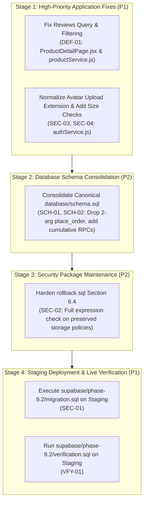

# ShopKart — Phase 3: Security Hardening & Master Security Audit
## Document 5: Prioritized Security Implementation Plan & Engineering Roadmap

**Audit Phase:** Phase 3 — Stage A (Planning & Engineering Design)  
**Execution Status:** PROPOSED (Awaiting explicit user approval before Stage B implementation)  
**Primary Focus:** Application Defect Remediation, Canonical Schema Reconciliation, Storage Hardening, and Production Verification

---

## 1. Master Implementation Sequence



---

## 2. Detailed Technical Engineering Specifications

### TASK 1: Fix Reviews Query Architecture (`DEF-01`)
- **Finding ID:** `DEF-01`
- **Files Affected:**
  - `src/pages/customer/ProductDetailPage.jsx:64,165`
  - `src/services/productService.js:420-440`
- **Vulnerability / Defect Description:** Approved customer reviews are completely hidden on product detail pages because `productService.js:435` filters by `r.product_name` (which is `undefined` on PostgreSQL records).
- **Root Cause:** Relational normalization: table `reviews` stores `product_id`, not `product_name`. PostgREST query `.select('*, profiles(...)')` does not return `product_name`.
- **Exploitation / Defect Scenario:** When a user visits any product page, `ProductDetailPage.jsx` calls `fetchProductReviews(data.name)`. The JavaScript filter `r.product_name && ...` evaluates to false for all rows, permanently returning an empty array.
- **Actual Impact:** Reviews feature is completely non-functional for customers.
- **Severity:** `HIGH` (P1)
- **Proposed Frontend Fix:**
  1. In `src/services/productService.js`:
     ```javascript
     export async function fetchProductReviews(productId) {
       if (!isMock()) {
         try {
           const { data, error } = await supabase
             .from('reviews')
             .select('*, profiles(full_name, avatar_url)')
             .eq('product_id', productId)
             .eq('is_approved', true)
             .order('created_at', { ascending: false })

           if (error) {
             console.error('[productService] Error fetching reviews from Supabase:', error)
             return { data: [], error }
           }
           return { data: data || [], error: null }
         } catch (err) {
           console.error('[productService] Exception fetching reviews from Supabase:', err)
           return { data: [], error: err }
         }
       }
       // Demo fallback continues to support mock storage
       ...
     }
     ```
  2. In `src/pages/customer/ProductDetailPage.jsx`:
     Update call sites at lines 64 and 165 from `fetchProductReviews(data.name)` to `fetchProductReviews(data.id)` and `fetchProductReviews(product.id)`.
- **Regression Risks:** Zero schema changes; zero impact on orders or cart.
- **Testing Procedure:**
  1. Insert a test approved review in the database for an active product.
  2. Navigate to that product detail page.
  3. Verify review appears with author name, avatar, rating stars, title, and body.
- **Rollback Strategy:** Revert lines in `ProductDetailPage.jsx` and `productService.js` via Git.

---

### TASK 2: Avatar Upload Extension Normalization & Input Validation (`SEC-03`, `SEC-04`)
- **Finding ID:** `SEC-03`, `SEC-04`
- **File Affected:** `src/services/authService.js:30-49`
- **Vulnerability Description:** Files with uppercase extensions (e.g. `.JPG`, `.PNG`) fail storage RLS policy checks because the SQL regex operator `~` is case-sensitive. Additionally, oversized files or non-image types are not rejected client-side.
- **Severity:** `LOW` (P3)
- **Proposed Frontend Fix:**
  In `src/services/authService.js:uploadAvatar`:
  ```javascript
  export async function uploadAvatar({ userId, file }) {
    if (!supabase) return { error: { message: 'Supabase not configured.' } }

    // 1. Client-side size & type validation
    const MAX_SIZE = 5 * 1024 * 1024 // 5 MB
    const ALLOWED_TYPES = ['image/jpeg', 'image/png', 'image/webp', 'image/gif']

    if (!file || file.size > MAX_SIZE) {
      return { error: { message: 'Avatar image must be less than 5 MB.' } }
    }
    if (!ALLOWED_TYPES.includes(file.type)) {
      return { error: { message: 'Only JPG, PNG, WEBP, and GIF images are allowed.' } }
    }

    // 2. Normalize extension to lowercase for case-sensitive PostgreSQL storage regex
    const rawExt = file.name.split('.').pop() || 'png'
    const ext = rawExt.toLowerCase()
    const path = `avatars/${userId}.${ext}`

    const { error: uploadError } = await supabase.storage
      .from('public-assets')
      .upload(path, file, { upsert: true })

    if (uploadError) return { error: uploadError }

    const { data } = supabase.storage
      .from('public-assets')
      .getPublicUrl(path)

    return { url: data.publicUrl, error: null }
  }
  ```
- **Testing Procedure:** Test uploading `test.JPG` (uppercase) and verify upload succeeds and public URL is returned.
- **Rollback Strategy:** Revert `src/services/authService.js` via Git.

---

### TASK 3: Consolidate Canonical `database/schema.sql` (`SCH-01`, `SCH-02`)
- **Finding ID:** `SCH-01`, `SCH-02`
- **File Affected:** `database/schema.sql:482`
- **Vulnerability / Defect Description:** Baseline `database/schema.sql` retains the obsolete 2-parameter signature `place_order(UUID, TEXT)` and is missing cumulative functions (`sync_user_cart`, `cancel_order`, `restore_inventory_on_cancellation`, `get_admin_customers`).
- **Severity:** `MEDIUM` (P2)
- **Proposed SQL Changes:**
  In `database/schema.sql`:
  1. Prepend `DROP FUNCTION IF EXISTS public.place_order(UUID, TEXT);`.
  2. Replace lines 482–600 with the production 3-parameter definition:
     ```sql
     DROP FUNCTION IF EXISTS public.place_order(UUID, TEXT);

     CREATE OR REPLACE FUNCTION public.place_order(
       p_address_id UUID,
       p_notes TEXT DEFAULT NULL,
       p_coupon_code TEXT DEFAULT NULL
     )
     RETURNS UUID
     LANGUAGE plpgsql
     SECURITY DEFINER
     SET search_path = ''
     AS $$
     ...
     ```
  3. Append the definitions for `sync_user_cart(JSONB)`, `cancel_order(UUID)`, `restore_inventory_on_cancellation()`, trigger `trg_restore_inventory_on_cancel`, and `get_admin_customers()`.
- **Testing Procedure:** Run local static syntax validation script against `database/schema.sql`.
- **Rollback Strategy:** Revert `database/schema.sql` via Git.

---

### TASK 4: Harden Storage Rollback Section 6.4 (`SEC-02`)
- **Finding ID:** `SEC-02`
- **File Affected:** `supabase/phase-9.2/rollback.sql:810-821`
- **Vulnerability Description:** Rollback postflight checks policy presence, command, and roles for preserved storage policies, but does not compare `v_cur.qual` and `v_cur.with_check` against `expected_definition`.
- **Severity:** `MEDIUM` (P2)
- **Proposed SQL Fix:**
  In `supabase/phase-9.2/rollback.sql:818`:
  ```sql
  IF v_cur.cmd <> v_rec.cmd OR v_cur.roles::text[] <> v_rec.roles
     OR (v_rec.expected_definition IS NOT NULL AND (
          regexp_replace(trim(coalesce(v_cur.qual, '')), '\s+', ' ', 'g') <> regexp_replace(trim(v_rec.expected_definition), '\s+', ' ', 'g')
          AND ('(' || regexp_replace(trim(coalesce(v_cur.qual, '')), '\s+', ' ', 'g') || ')') <> regexp_replace(trim(v_rec.expected_definition), '\s+', ' ', 'g')
        )) THEN
    RAISE EXCEPTION 'ROLLBACK POSTFLIGHT FAIL: Pre-existing storage policy "%" definition was modified!', v_rec.policyname;
  END IF;
  ```
- **Testing Procedure:** Execute `node test_phase9_2_validation.mjs .` and verify 45/45 assertions pass.
- **Rollback Strategy:** Revert lines in `supabase/phase-9.2/rollback.sql` via Git.

---

### TASK 5: Staging Migration & Live Verification (`SEC-01`, `VFY-01`)
- **Finding ID:** `SEC-01`, `VFY-01`
- **Target:** Supabase Staging (`ulmwssozdmppvydppswx`)
- **Execution Mode:** Operational manual deployment in Supabase Dashboard SQL Editor (Requires User Approval).
- **Procedure:**
  1. Open Supabase Dashboard for project `ulmwssozdmppvydppswx`.
  2. Paste and execute `supabase/phase-9.2/migration.sql`. Confirm output: `Phase 9.2 Complete Security Hardening executed successfully`.
  3. Paste and execute `supabase/phase-9.2/verification.sql`.
  4. Confirm that all 18 sections output `PASS` and zero assertion errors are raised.

---

## 3. Strict Safety & Boundary Affirmation

**Stage A is complete.**  
No source code, SQL migrations, rollback scripts, or configurations have been altered.  
We await your review and explicit approval before entering Stage B (Implementation).
