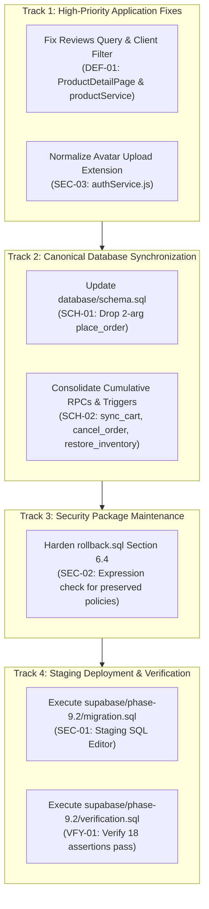

# ShopKart — Phase 3 Readiness & Implementation Roadmap

**Document Purpose:** Readiness assessment, dependency graph, and implementation roadmap transitioning from Phase 2 Audit to Phase 3 Implementation.  
**Current State:** Audit Phase Finalized (Zero code or SQL changes made).  
**Execution Gate:** STRICTLY BLOCKED awaiting explicit user decision and approval.

---

## 1. Readiness Assessment: Can Phase 3 Begin?

### Assessment Verdict: **CONDITIONAL READINESS**

The audit phase is 100% complete. All discrepancies between audit reports, application source code, and SQL migrations have been resolved and factually verified. The repository is stable, with a clean production build (`npm run build` in 961 ms) and zero runtime syntax errors.

However, moving from audit into Phase 3 implementation requires user sign-off and explicit alignment on three specific prerequisites.

---

## 2. Prerequisites & Pre-Implementation Checklist

| # | Prerequisite Item | Status | Action Required Prior to Implementation |
| :- | :--- | :---: | :--- |
| 1 | **Phase 2 Audit Approval** | PENDING | User review and explicit approval of final reports |
| 2 | **Staging Deployment Strategy** | DECISION REQ | Decide whether to apply Phase 9.2 to remote Staging now or after local fixes |
| 3 | **Canonical Schema Strategy** | DECISION REQ | Approve consolidating cumulative stored procedures into `database/schema.sql` |

---

## 3. Security Blockers & Technical Risks

1. **Storage Rollback Preserved Policy Defect (`SEC-02`):**
   - *Risk:* In `supabase/phase-9.2/rollback.sql:818`, postflight verification checks policy existence, `cmd`, and `roles`, but does not evaluate `qual` (`USING`) and `with_check` for pre-existing storage policies.
   - *Requirement:* Must be corrected in `rollback.sql` before any production rollback testing is executed.
2. **Avatar Extension Case Sensitivity (`SEC-03`):**
   - *Risk:* Storage RLS policy enforces lowercase extensions (`.jpg`, `.png`). Uploads with uppercase extensions (e.g. `.JPG`) are rejected by PostgreSQL RLS.
   - *Requirement:* `authService.js:uploadAvatar` must lowercase extensions prior to upload.
3. **Pending Remote Staging Hardening (`SEC-01`):**
   - *Risk:* Staging database (`ulmwssozdmppvydppswx`) runs legacy default permissions until `migration.sql` is executed.

---

## 4. Technical Dependencies & Cross-Module Relationships

---

## 5. Recommended Phase 3 Implementation Order

### Step 1: Customer-Facing Application Defects (Zero Schema Risk)
- **Task 1.1 (DEF-01):** Fix review display in `src/pages/customer/ProductDetailPage.jsx` and `src/services/productService.js`. Update `fetchProductReviews` to take `productId` and filter using `.eq('product_id', productId)`. Remove the broken `r.product_name` JavaScript filter.
- **Task 1.2 (SEC-03):** Update `src/services/authService.js:uploadAvatar` to normalize file extensions to lowercase before uploading to Supabase Storage.

### Step 2: Canonical Database Schema Consolidation
- **Task 2.1 (SCH-01):** Update `database/schema.sql` to replace the obsolete 2-parameter `place_order` signature with the 3-parameter coupon signature, prepending `DROP FUNCTION IF EXISTS public.place_order(UUID, TEXT);`.
- **Task 2.2 (SCH-02):** Consolidate `sync_user_cart`, `cancel_order`, `get_admin_customers`, and `restore_inventory_on_cancellation` (with trigger) into `database/schema.sql` to eliminate documentation drift.

### Step 3: Phase 9.2 Package Refinement
- **Task 3.1 (SEC-02):** Refine Section 6.4 in `supabase/phase-9.2/rollback.sql` (line 818) to verify that `v_cur.qual` and `v_cur.with_check` match `expected_definition` for preserved policies.

### Step 4: Staging Deployment & Live Verification
- **Task 4.1 (SEC-01):** Apply `supabase/phase-9.2/migration.sql` to the remote Supabase Staging project (`ulmwssozdmppvydppswx`) via the SQL Editor.
- **Task 4.2 (VFY-01):** Run `supabase/phase-9.2/verification.sql` to verify all 18 assertions pass on live staging catalog objects.

### Step 5: Platform Enhancements (Non-Blocking)
- **Task 5.1 (FEAT-01):** Create `public.settings` table in a future migration to replace client-side `localStorage` persistence in `AdminSettingsPage.jsx`.
- **Task 5.2 (WRK-01):** Update checkout flow to write audit records into `public.payments`.

---

## 6. Explicit Items Requiring User Decision & Approval

Before any code editing or SQL execution begins, please provide decisions on:

1. **Audit Sign-Off:** Do you approve the conclusions and findings register in `SHOPKART_PHASE2_FINAL_AUDIT.md` and `SHOPKART_FINAL_FINDINGS_REGISTER.md`?
2. **Staging Execution Gate:** Do you wish to execute the Phase 9.2 hardening migration on Supabase Staging now, or should we complete Step 1 (client-side fixes) first?
3. **Approval to Begin Phase 3:** Do you authorize proceeding to Phase 3 Step 1 (fixing the reviews defect in `ProductDetailPage.jsx` and `productService.js`)?

**Awaiting your explicit instruction to proceed.**
